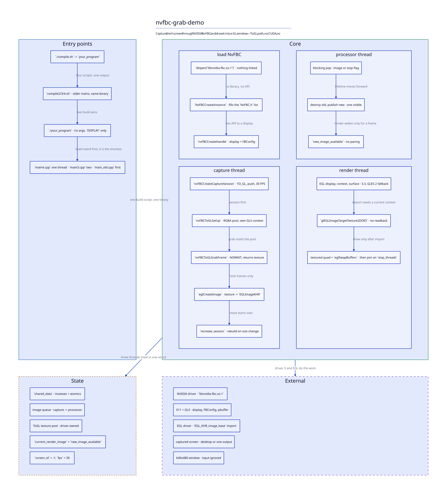

# nvfbc-grab-demo

Four iterations of one experiment: capture the X screen out of the NVIDIA driver with NvFBC and draw it into an OpenGL window — the ToGL path, with no CUDA and no encoder.

Read it left to right:

- **The repository is the version history.** `compile.sh` builds `main.cpp`; `compile2.sh`, `compile3.sh` and `compile4.sh` build `main_old.cpp`, `main3.cpp` and `main4.cpp`. All four write the same `your_program`, so whichever script ran last is the binary you have. Read `main4.cpp` first (one loop, one context), then `main3.cpp` (capture and render split across two GLX threads), then `main.cpp` (EGL, three threads, shared-image hand-off).
- **NvFBC is never linked, only loaded.** `NvFBC.h` is the vendored 1.8 API header and `libnvidia-fbc.so.1` is `dlopen`ed at startup; `NvFBCCreateInstance` fills the function-pointer list, then `nvFBCCreateHandle` binds that API to one X display and one FBConfig. Nothing imports `libcuda`.
- **The frame moves GPU-side, through an `EGLImage`.** The capture thread owns its own X display, GLX pbuffer and context, because every NvFBC call needs a current context. A grab returns an index into the driver's ToGL texture pool; that texture is wrapped with `eglCreateImage(EGL_GL_TEXTURE_2D)` and queued. The processor thread destroys the previous image and publishes the new one, and the render thread imports it with `glEGLImageTargetTexture2DOES` and draws a textured quad. No `glReadPixels`, no CPU copy.
- **Settings are compile-time fields, not options.** `screen_id = -1` (whole desktop, otherwise `NVFBC_TRACKING_OUTPUT` with that id as `dwOutputId`) and `fps = 30` live in `shared_data`; there is no argv parsing and no config file. `recreate_session` tears down and rebuilds the capture session when settings change, and `stop_threads` (set by closing the window) joins both worker threads before cleanup.
- **It is a capture rig, not an app.** The window is 640×480, its title is never set, notifications are drained but ignored, and rendering happens only when `new_image_available` is set — a frame nobody captured costs nothing. The remaining unknown: on a screen with no new frame the demo keeps the last one, so it never shows how stale the picture actually is.

Diagram source: [`docs/system.d2`](docs/system.d2) · renderer: [`scripts/render-diagram.sh`](scripts/render-diagram.sh).
